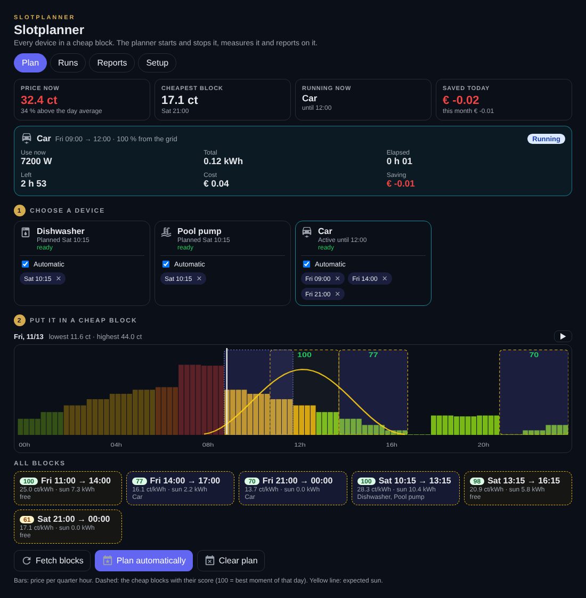
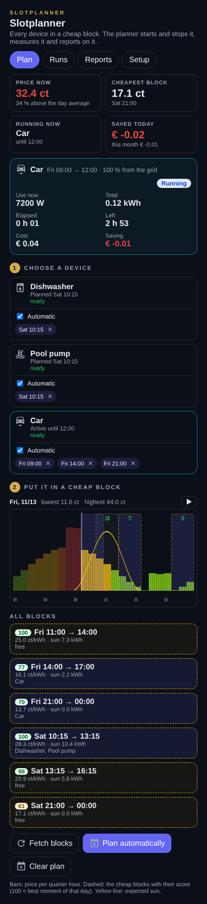
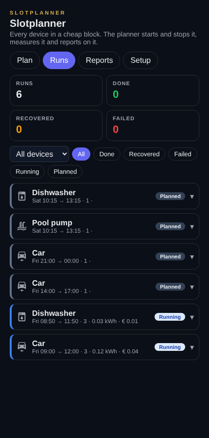
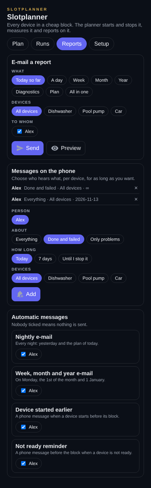

# Slotplanner for Home Assistant

Run your washing machine, dishwasher, car charger, pool pump or air conditioning in the cheapest hours of the day. The Slotplanner reads your dynamic energy prices and your solar forecast, finds the cheapest blocks of a few hours, plans your devices into them, starts and stops them, measures what each run used and cost, and tells you what it saved.

Everything runs inside Home Assistant as a package: templates, scripts and two automations. There is no custom integration to install and nothing to build. You fill in **one file** with your devices and sources.



## What it does

- **Finds cheap blocks.** Every day at 17:00 it reads today's and tomorrow's quarter-hour prices and looks for the cheapest blocks (3 hours by default) that do not overlap. Expected sun counts as cheap power: up to a few kW of a block is valued at your feed-in price.
- **Scores every block from 0 to 100.** 100 is the best moment of that day, 0 the most expensive block.
- **Plans devices.** Tap a device and a block in the card, or let the planner do it at midnight: appliances as soon as they are loaded and ready, the car with as many blocks as it needs to reach its target, pumps and climate devices once a day.
- **Respects your capacity tariff.** Two devices may share a block only if they stay under this month's peak. Never more than two per block.
- **Starts and stops devices.** Remote start for appliances (Miele and any brand with a status sensor and a start button), switches, climate entities, EV chargers, or your own actions. Appliances with a known run time start in the cheapest part of their block.
- **Follows every run.** It notices when a program is finished and frees the rest of the block, when the car is full, when someone switches a device off by hand, when a device started earlier than planned, and when a pause entity (your own peak guard) is on. A device that loses its connection is not taken for finished, and whatever the planner switched on is switched off again, also after a failed attempt or when you remove a device from the configuration.
- **Measures.** kWh, the part that came from the grid, the cost per quarter hour and the saving compared with the average price of the day. After two runs it learns the real peak power and run time of each device.
- **Explains what went wrong.** Every run keeps a timeline of steps. When a start fails it gives the most likely cause (door open, remote start off, no program set, offline) and plans the device again once.
- **Reports.** A nightly e-mail, week, month and year overviews, and e-mails on demand. Phone messages per person, per device, for as long as you want.
- **English and Dutch.** Card, messages and e-mails follow the language in the configuration.

| Plan | Runs | Reports |
|---|---|---|
|  |  |  |

## Requirements

- Home Assistant 2025.1 or newer (tested on 2026.2.3).
- A dynamic price source: Frank Energie, Nord Pool (official or HACS), ENTSO-e, Tibber, or any sensor with a list of prices in an attribute.
- Optional: a solar forecast (Forecast.Solar or Solcast), a grid power sensor, a monthly peak sensor, power sensors for your devices, a notify action for e-mail.

## Install

1. Make sure packages are on in `configuration.yaml`:

   ```yaml
   homeassistant:
     packages: !include_dir_named packages
   ```

2. Copy the contents of the `config` folder of this repository into your Home Assistant configuration folder:

   ```
   config/packages/slotplanner.yaml                   -> /config/packages/
   config/custom_templates/slotplanner*.jinja         -> /config/custom_templates/
   config/www/slotplanner/slotplanner-card.js         -> /config/www/slotplanner/
   ```

3. Edit `/config/custom_templates/slotplanner_config.jinja`. This is the only file you change. See [Configuration](#configuration).

4. Restart Home Assistant.

5. Add the card. Settings > Dashboards > Resources > Add resource: `/local/slotplanner/slotplanner-card.js`, type *JavaScript module*. Then add a card to a dashboard:

   ```yaml
   type: custom:slotplanner-card
   ```

   A panel view gives it the most room. See [examples/dashboard.yaml](examples/dashboard.yaml).

6. Open the **Setup** tab of the card. It lists every entity it cannot find and every field that is missing.

After every later change to the configuration file, run the script **Slotplanner: reload configuration**. No restart needed.

### Recorder

The planner keeps its state, history and statistics in sensor attributes. Those are larger than the recorder wants to store, so leave them out of the database:

```yaml
recorder:
  exclude:
    entity_globs:
      - sensor.slotplanner_*
```

The values survive a restart anyway: trigger-based template sensors restore their last state.

## Configuration

Open `custom_templates/slotplanner_config.jinja`. It is a Jinja file with a few blocks, each with comments that explain every field. A full example of a real house is in [examples/slotplanner_config.example_be_frank_miele.jinja](examples/slotplanner_config.example_be_frank_miele.jinja), and every field is described in [docs/CONFIGURATION.md](docs/CONFIGURATION.md).

```jinja








```

### Price sources

| `source` | Integration | What to fill in | Tested |
|---|---|---|---|
| `frank` | Frank Energie (HACS) | `today`, `tomorrow` | live, daily use |
| `nordpool_hacs` | Nord Pool (HACS, custom-components/nordpool) | `today` | with a test sensor in the same format |
| `entsoe` | ENTSO-e (HACS, JaccoR/hass-entso-e) | `today` | following the integration's documentation |
| `nordpool` | Nord Pool (official) | `config_entry`, `area` | following the documentation of `nordpool.get_prices_for_date` |
| `tibber` | Tibber (official) | nothing | following the documentation of `tibber.get_prices` |
| `custom` | anything else | `today`, `tomorrow`, `attributes`, `time_key`, `price_key`, `unit` | |

Market prices (Nord Pool, ENTSO-e) do not include taxes and fees. Use `multiply` and `add` to turn them into what you really pay. Hourly prices are split into quarter hours.

### Device types

| `type` | For | Starts with | Knows it is done when |
|---|---|---|---|
| `appliance` | washing machine, dryer, dishwasher with remote start | the start button, when the status is a ready state | the status leaves the running states |
| `switch` | anything on a smart plug or relay | `switch.turn_on` | the power stays under `finish_below_w` (optional), else at the end of the block |
| `climate` | air conditioning, heat pumps | `climate.set_hvac_mode` (and a temperature) | end of the block |
| `ev` | car chargers | a switch, or your own actions | the battery reaches its target |
| `custom` | everything else | your `start_actions` | `running_entity` goes off (optional), else at the end of the block |

Every device can also run extra `start_actions` and `stop_actions` in the same format as a script step.

## How the planning works

1. **Prices.** `script.slotplanner_fetch_prices` reads the source and stores every quarter hour in `sensor.slotplanner_prices`. It runs at start-up, every hour and before every search.
2. **Solar.** With Forecast.Solar the day total is spread over a sine curve between sunrise and sunset; with Solcast the half-hour forecast is used as is. A correction factor per part of the day is optional.
3. **Effective price.** For every quarter: `price × (1 − f) + feed_in × f`, where `f` is the share of a device of `covers_kw` that the sun can cover.
4. **Blocks.** The cheapest block of `block_hours` is chosen first, then the next one that does not overlap, until there are `blocks_per_day`. Blocks that already hold a plan stay where they are.
5. **Autoplan.** At `autoplan_time` every device with autoplan gets the cheapest free block for its own power (a small device gets more out of the sun than a big one), as long as it fits next to what is already in that block.
6. **Executor.** Every minute `automation.slotplanner_executor` runs the logic in `slotplanner_tick.jinja`: start, follow, pause, finish, measure and tidy up.

## Entities and scripts

| Entity | What |
|---|---|
| `sensor.slotplanner_config` | the parsed configuration and the setup check (`errors`) |
| `sensor.slotplanner_state` | all plans, settings and what the planner switched on |
| `sensor.slotplanner_prices` | quarter-hour prices |
| `sensor.slotplanner_slots` | the cheap blocks with price, sun and score |
| `sensor.slotplanner_history` | the last 80 finished runs with steps and measurement |
| `sensor.slotplanner_stats` | saved this year; week, month and year totals and what it learned |

| Script | Fields |
|---|---|
| `script.slotplanner_plan` | `device`, `start` (epoch), `move_from` (plan id) |
| `script.slotplanner_unplan` | `plan_id` |
| `script.slotplanner_autoplan` | |
| `script.slotplanner_refresh` | fetch prices and find blocks |
| `script.slotplanner_clear` | remove every block that did not start |
| `script.slotplanner_settings` | `settings`: `enabled`, `autoplan` (merged per device), `nightly`, `overview`, `early`, `remind` |
| `script.slotplanner_write` | `ops`: the only way the state changes. Besides plan operations it takes `sub_add`, `sub_del` and `list_set` for message settings, see `slotplanner_store.jinja` |
| `script.slotplanner_release` | `entities`: switches off what the planner switched on but no block owns any more. The executor calls it every minute until they are off |
| `script.slotplanner_mail` | `report` (today, day, night, week, month, year, diagnostics, plan, all), `day`, `days`, `devices`, `people` |
| `script.slotplanner_reload` | reload the configuration |

You can use them in your own automations, for example to plan the dishwasher from a button next to it:

```yaml
action: script.slotplanner_plan
data:
  device: dishwasher
  start: "{{ sp_free_slot('dishwasher', 7200) }}"
```

## Testing without real devices

`tests/` holds a Home Assistant configuration with a mock house: a dishwasher with a start button, a pool pump, a car on a charger, a Nord Pool style price sensor and a solar forecast.

```bash
python3 -m venv .venv && .venv/bin/pip install homeassistant
tests/run.sh .venv
```

Open http://localhost:8123, add the card and plan something. `tests/card_test.js` renders the card in Chromium against that instance.

## Background

The Slotplanner started as part of a home energy system in Belgium: a dynamic contract, solar panels, a home battery, a capacity tariff, three Miele appliances, a car and a pool. It ran there daily before it was turned into this package.

## License

MIT. See [LICENSE](LICENSE).
